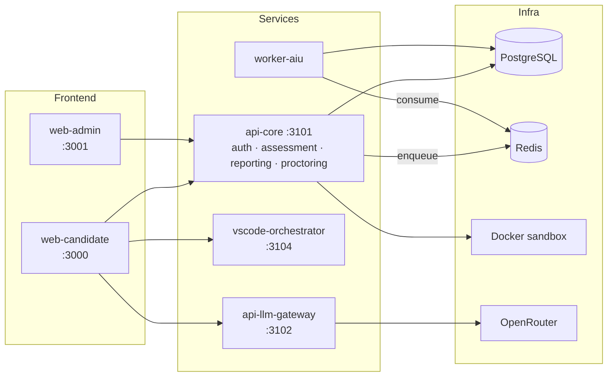

<div align="center">


<br/>

**The AI-native coding assessment platform — measure who can actually _build with AI_, not who can beat a whiteboard.**

<br/>


[]()
[]()
[]()
[]()
[]()

[]()
[]()
[]()

</div>

---

## What it is

**apexcoder.io** is a web platform for AI-integrated coding assessments. Candidates solve problems
in a real browser IDE (Monaco) with an embedded AI assistant. Unlike a traditional coding test,
apexcoder scores **two** things:

1. **Code correctness** — the solution is run against visible and hidden test cases in a sandbox.
2. **AI Usage Evaluation (AIU)** — *how well the candidate worked with the AI assistant* — prompt
   quality, iteration efficiency, independent editing, and contextual relevance.

It is not "HackerRank with a chatbot." It is a hiring signal for AI-native engineering ability.

There are two roles: **Candidate** (takes the assessment) and **Admin** (authors assessments,
invites candidates, and reviews reports).

---

## Key Features

- 🧑‍💻 **Real browser IDE** — Monaco editor with per-language tooling (Python / JavaScript / TypeScript), autocomplete disabled for fair assessment.
- 🤖 **Embedded AI assistant** — proxied through an OpenRouter gateway; every prompt/response is logged for scoring.
- 📊 **AIU scoring engine** — a background worker scores four dimensions of AI usage after submission.
- 🔒 **Assessment integrity** — hidden test cases never reach the browser, large-paste and copy/paste controls, one-time invite tokens.
- 🏢 **Admin console** — assessment authoring, candidate invites, leaderboard, per-candidate reports, and PDF export.
- 🐳 **One-command backend** — Postgres, Redis, migrations, seed, and all services via Docker Compose.

---

## Architecture



Monorepo layout:

```
apps/web-candidate     — Candidate IDE (React + Vite, port 3000)
apps/web-admin         — Admin dashboard (React + Vite, port 3001)
apps/api-core          — Auth + session lifecycle/code execution + reporting + proctoring (port 3101)
apps/api-llm-gateway   — OpenRouter proxy + interaction logging (port 3102)
apps/vscode-orchestrator — VS Code session orchestrator (port 3104)
apps/worker-aiu        — Background AIU scoring worker (no HTTP port)
sandbox/runner       — Docker-based code execution runner
packages/db          — Prisma schema + generated client
packages/types       — Shared Zod schemas + TypeScript types
packages/config      — Shared env validation
packages/logger      — Shared Pino logger
```

---

## Tech Stack

| Layer | Technology |
|---|---|
| Frontend | React 18 · TypeScript · Vite · Tailwind CSS · Zustand · TanStack Query · Monaco Editor |
| Backend | Fastify (Node.js 20 LTS) · Zod validation |
| Data | PostgreSQL 16 (Prisma ORM) · Redis 7 (BullMQ queue) |
| AI | OpenRouter LLM gateway |
| Sandbox | Docker (ephemeral, network-isolated containers) |
| Tooling | Turborepo · Docker Compose · Vitest / Jest |

---

## Prerequisites

- [Node.js 20 LTS](https://nodejs.org/)
- [Docker Desktop](https://www.docker.com/products/docker-desktop/) (includes Docker Compose v2) — **must be running before you start the backend**

---

## Quickstart

Run each command from the **repo root**. Start Docker Desktop first.

```bash
# 1. Install dependencies
npm install

# 2. Start the backend: DB + Redis, then migrate, seed, and all API services.
#    Dev credentials (DB, JWT) are baked into docker-compose.yml — no .env needed for local dev.
npm run backend

# 3. Start the frontends — each in its own terminal:
npm run dev:candidate   # http://localhost:3000
npm run dev:admin       # http://localhost:3001
```

`npm run backend` brings up Postgres + Redis, applies Prisma migrations, seeds the
database, then starts all backend services in Docker. It is idempotent — safe
to re-run. Stop the backend with `npm run backend:down`.

> Run the two frontends in **separate terminals** (`dev:candidate`, `dev:admin`).
> The combined `npm run dev` (turbo) multiplexes both dev servers in one process and
> may fail to bind port 3001 — the per-app scripts are reliable.

**Log in:**
- Admin — http://localhost:3001/login with the seeded account `admin@test.com` / `admin123`
- Candidate — starts from an invite link generated in the admin console (per assessment)

---

## Service URLs

| Service | URL |
|---|---|
| Candidate app | http://localhost:3000 |
| Admin app | http://localhost:3001 |
| api-core (auth · assessment · reporting · proctoring) | http://localhost:3101 |
| api-llm-gateway | http://localhost:3102 |
| PostgreSQL | localhost:5432 |
| Redis | localhost:6379 |

---

## npm Commands (run from repo root)

| Command | Description |
|---|---|
| `npm run backend` | Start DB + Redis, migrate, seed, then all API services (Docker). Idempotent. |
| `npm run backend:down` | Stop all backend Docker services |
| `npm run dev:candidate` | Start the candidate frontend on http://localhost:3000 |
| `npm run dev:admin` | Start the admin frontend on http://localhost:3001 |
| `npm run build` / `npm run test` / `npm run lint` | Turborepo build / test / lint across all packages |
| `npm run test:e2e` | Run the end-to-end (Playwright) test suite |

---

## Make Commands (alternative; requires GNU Make)

| Command | Description |
|---|---|
| `make dev` | Start Docker services (detached) + Vite dev servers |
| `make down` | Stop all Docker services |
| `make logs` | Follow logs from all Docker services |
| `make build` | Build all packages and apps via Turborepo |
| `make test` | Run all tests across all packages |
| `make db:migrate` | Run Prisma migrations against local DB |
| `make db:seed` | Seed the database with initial data |
| `make db:reset` | Drop and recreate the database, then migrate and seed |

---

## AI Usage Evaluation (AIU)

After a candidate submits, the `worker-aiu` background worker reads the full interaction log and
scores four dimensions of how the candidate used the AI assistant:

| Metric | What it rewards |
|---|---|
| **Prompt quality** | Clear, contextual, specific prompts that improve over time |
| **Iteration efficiency** | Reaching a correct solution without excessive back-and-forth |
| **Independent editing** | Writing/adapting code rather than pasting AI output verbatim |
| **Contextual relevance** | Asking high-value questions (tests, syntax, explanations) over "solve this for me" |

Metric weights are configurable per assessment and must sum to 100. **AIU scores are never shown
to candidates** — they are visible only to admins in reports and the leaderboard.

---

## Default Admin Credentials

| Email | Password |
|---|---|
| admin@test.com | admin123 |

---

## Verify Setup

```bash
# Health checks
curl http://localhost:3101/health   # api-core
curl http://localhost:3102/health   # api-llm-gateway

# Test login (api-core)
curl -X POST http://localhost:3101/api/v1/auth/login \
  -H "Content-Type: application/json" \
  -d '{"email": "admin@test.com", "password": "admin123"}'
```

---

## OpenRouter API Key

The LLM gateway uses [OpenRouter](https://openrouter.ai/) to proxy AI requests. The free tier is sufficient for development.

**Via admin UI (recommended):**
1. Log in to the admin app at http://localhost:3001.
2. Go to **Settings**.
3. Paste your OpenRouter API key and save.

**Via API:**
```bash
curl -X POST http://localhost:3102/api/v1/admin/config/openrouter-key \
  -H "Content-Type: application/json" \
  -H "Authorization: Bearer <admin_token>" \
  -d '{"api_key": "your-openrouter-key"}'
```

The key is encrypted with AES-256-GCM before storage and is never logged or returned in responses. The encryption key (`OPENROUTER_ENCRYPTION_KEY`) is set in `docker-compose.yml` for local dev; use a real 64-character hex secret in production.

---

## Testing

```bash
npm run test        # unit + integration across all packages (Turborepo)
npm run test:e2e    # end-to-end (Playwright)
npm run lint        # lint all packages
```

The repo includes unit, integration, end-to-end, security, and load-test suites across the
backend services, workers, sandbox runner, and frontends.

---

## Project & Team

Built for **AI Coding: Modern Software Development** (TUM, module `CITHN2015`, 6 ECTS) — **Group 12**,
Topic A: *Online AI-Coding Assessment / Interview Platform*.

This is an academic course project and is not licensed for production or commercial use.
# codenerve_new_test1

